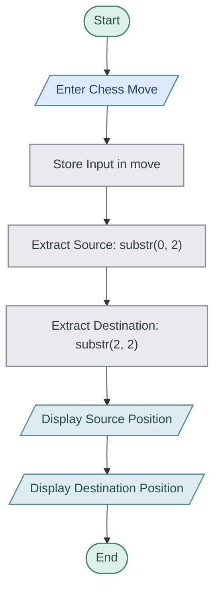

# String Parsing in C++

**Project:** Terminal-Based Chess Game  
**Step:** 05  
**Language:** C++

## Table of Contents

- [1. Introduction](#1-introduction)
- [2. String Parsing](#2-string-parsing)
- [3. Understanding the Input](#3-understanding-the-input)
- [4. C++ Implementation](#4-c-implementation)
- [5. Code Explanation](#5-code-explanation)
- [6. Understanding `substr()`](#6-understanding-substr)
- [7. Parsing Process](#7-parsing-process)
- [8. Program Flowchart](#8-program-flowchart)
- [9. Output](#9-output)
- [10. Conclusion](#10-conclusion)

---

## 1. Introduction

In this step, we will process the chess move entered by the player.

The player enters a move in the following format:

```text
e2e4
```

The input represents two positions:

- `e2`: The square from which the piece moves.
- `e4`: The square to which the piece moves.

To work with these positions separately, we need to extract them from the input string. This is done using string parsing.

## 2. String Parsing

String parsing involves examining a string and extracting specific parts of it based on a defined structure.

In our chess game, each move consists of four characters:

```text
e2e4
```

We divide these characters into two parts:

```text
e2 | e4
```

- `e2` represents the source position.
- `e4` represents the destination position.

Both positions can then be stored in separate string variables.

## 3. Understanding the Input

Before extracting the positions, let's look at how the input string is organized.

```cpp
string move = "e2e4";
```

Each character in a string has an index, starting from `0`.

| Character | e | 2 | e | 4 |
|-----------|---|---|---|---|
| Index | 0 | 1 | 2 | 3 |

Based on these indexes:

- Index `0` and `1` contain the source position.
- Index `2` and `3` contain the destination position.

We can use these indexes with the `substr()` function to extract both positions.

## 4. C++ Implementation

```cpp
#include <iostream>
#include <string>
using namespace std;

int main() {

    string move;

    cout << "Enter your move: ";
    cin >> move;

    string from = move.substr(0, 2);
    string to = move.substr(2, 2);

    cout << "From: " << from << endl;
    cout << "To: " << to << endl;

    return 0;
}
```

## 5. Code Explanation

### 1. Header Files

```cpp
#include <iostream>
#include <string>
```

- `iostream` provides input and output functionality.
- `string` provides the string class and its associated functions.

### 2. Namespace

```cpp
using namespace std;
```

Allows us to access standard library components without prefixing them with `std::`.

### 3. Main Function

```cpp
int main() {
```

The `main()` function is the entry point of the program. Execution begins here.

### 4. Declaring the String

```cpp
string move;
```

Declares a string variable named `move` to store the player's input.

### 5. Taking Input

```cpp
cout << "Enter your move: ";
cin >> move;
```

Displays a prompt and reads the move entered by the player.

For example:

```text
e2e4
```

The entered value is stored in `move`.

### 6. Extracting the Source Position

```cpp
string from = move.substr(0, 2);
```

Extracts two characters starting from index `0`.

- Starting index: `0`
- Length: `2`

The extracted value is:

```cpp
from = "e2";
```

### 7. Extracting the Destination Position

```cpp
string to = move.substr(2, 2);
```

Extracts two characters starting from index `2`.

- Starting index: `2`
- Length: `2`

The extracted value is:

```cpp
to = "e4";
```

### 8. Displaying the Positions

```cpp
cout << "From: " << from << endl;
cout << "To: " << to << endl;
```

Displays both extracted positions separately.

### 9. Return Statement

```cpp
return 0;
```

Terminates the program and indicates successful execution.

## 6. Understanding `substr()`

The `substr()` function is a member function of the C++ `string` class. It returns a new string containing a specified portion of the original string.

**Syntax:**

```cpp
string.substr(starting_index, length);
```

| Parameter | Description |
|-----------|-------------|
| `starting_index` | Index from which extraction begins |
| `length` | Number of characters to extract |

### Example

```cpp
string text = "HELLO";

string result = text.substr(1, 3);

cout << result;
```

**Output:**

```text
ELL
```

**Explanation:**

- Starting index: `1`
- Length: `3`
- Extracted substring: `ELL`

The `length` parameter specifies how many characters to extract, not the ending index.

## 7. Parsing Process

Let's follow the execution using the input `e2e4`.

**Step 1: Receive the input**

```text
e2e4
```

**Step 2: Store the input**

```cpp
string move = "e2e4";
```

**Step 3: Extract the source position**

```cpp
string from = move.substr(0, 2);
```

Result: `e2`

**Step 4: Extract the destination position**

```cpp
string to = move.substr(2, 2);
```

Result: `e4`

**Step 5: Store both positions**

```text
from = e2
to   = e4
```

The original input has now been separated into two strings.

## 8. Program Flowchart



## 9. Output

**Input:**

```text
Enter your move: e2e4
```

**Output:**

```text
From: e2
To: e4
```

## 10. Conclusion

In this step, we used string parsing to separate a chess move into its source and destination positions.

The `substr()` function allowed us to extract the required characters using their indexes.

We can now use the `from` and `to` variables separately when implementing the move-processing logic of our chess game.

---

**Next Step:** Use the extracted positions to process a chess move.
