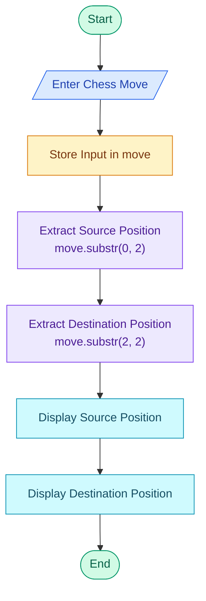

# String Parsing in C++

**Project:** Terminal-Based Chess Game  
**Step:** 05  
**Language:** C++

## 📄 Table of Contents

- [1. Introduction](#1-introduction)
- [2. What is String Parsing?](#2-what-is-string-parsing)
- [3. Understanding the Input](#3-understanding-the-input)
- [4. C++ Code](#4-c-code)
- [5. Code Explanation](#5-code-explanation)
- [6. Understanding `substr()`](#6-understanding-substr)
- [7. How Parsing Works](#7-how-parsing-works)
- [8. Program Flowchart](#8-program-flowchart)
- [9. Output](#9-output)
- [10. Conclusion](#10-conclusion)

---

## 1. Introduction

In our Terminal-Based Chess Game, the player enters a chess move as a single string.

For example:

```cpp
e2e4
```

This input contains two different pieces of information:

- `e2` = Source Position (Starting Square)
- `e4` = Destination Position (Target Square)

Our program needs to separate these two positions so that they can be processed individually.

For this purpose, we use **String Parsing**.

## 2. What is String Parsing?

String Parsing is the process of analyzing a string and extracting smaller meaningful parts from it.

For example:

```cpp
string move = "e2e4";
```

We can divide this string into two meaningful parts:

```text
Original String: e2e4

       e2       e4
        |        |
     Source  Destination
```

After parsing:

```cpp
from = "e2";
to   = "e4";
```

This allows our program to extract and work with individual pieces of information from a single string.

## 3. Understanding the Input

Consider the following string:

```cpp
string move = "e2e4";
```

A string stores characters in a sequence. Each character has a specific index.

| Character | e | 2 | e | 4 |
|-----------|---|---|---|---|
| Index     | 0 | 1 | 2 | 3 |

**Important:** String indexing in C++ starts from `0`, not `1`.

Therefore:

- Index `0` contains `e`.
- Index `1` contains `2`.
- Index `2` contains `e`.
- Index `3` contains `4`.

We can use these indexes to extract the source and destination positions.

## 4. C++ Code

```cpp
#include <iostream>
#include <string>
using namespace std;

int main() {

    string move;

    cout << "Enter your move: ";
    cin >> move;

    string from = move.substr(0, 2);
    string to = move.substr(2, 2);

    cout << "From: " << from << endl;
    cout << "To: " << to << endl;

    return 0;
}
```

## 5. Code Explanation

### 1. Header Files

```cpp
#include <iostream>
#include <string>
```

- `iostream`: Allows us to take input and display output.
- `string`: Allows us to use the C++ string class and its functions.

### 2. Namespace

```cpp
using namespace std;
```

Allows us to use standard C++ objects and functions without repeatedly writing `std::`.

### 3. Main Function

```cpp
int main() {
```

The execution of our program starts from the `main()` function.

### 4. String Declaration

```cpp
string move;
```

We declare a string variable named `move` to store the chess move entered by the player.

### 5. Taking Input

```cpp
cout << "Enter your move: ";
cin >> move;
```

- `cout` displays a message on the screen.
- `cin` takes input from the player.
- The entered move is stored in the `move` variable.

**Example Input:**

```text
e2e4
```

### 6. Extracting Source Position

```cpp
string from = move.substr(0, 2);
```

We use the `substr()` function to extract the first two characters from the original string.

- `0` = Starting index.
- `2` = Number of characters to extract.

**Result:**

```cpp
from = "e2";
```

### 7. Extracting Destination Position

```cpp
string to = move.substr(2, 2);
```

We use `substr()` again to extract the next two characters.

- `2` = Starting index.
- `2` = Number of characters to extract.

**Result:**

```cpp
to = "e4";
```

### 8. Displaying Results

```cpp
cout << "From: " << from << endl;
cout << "To: " << to << endl;
```

Displays the extracted source and destination positions.

### 9. Return Statement

```cpp
return 0;
```

Indicates that the program has finished successfully.

## 6. Understanding `substr()`

`substr()` is a built-in C++ string function used to extract a substring from an existing string.

**Syntax:**

```cpp
string.substr(starting_index, length);
```

| Parameter | Meaning |
|-----------|---------|
| `starting_index` | The index where extraction begins |
| `length` | The number of characters to extract |

### Example

```cpp
string text = "HELLO";

string result = text.substr(1, 3);

cout << result;
```

**Output:**

```text
ELL
```

**Explanation:**

- Starting Index = `1`
- Length = `3`
- Extracted Characters = `ELL`

**Important Note:** The second parameter represents the number of characters to extract, not the ending index.

## 7. How Parsing Works

Let's understand the complete execution step by step.

### Step 1: Input

The player enters:

```text
e2e4
```

### Step 2: Store Input

```cpp
string move = "e2e4";
```

The complete input is stored in the `move` variable.

### Step 3: Extract Source Position

```cpp
string from = move.substr(0, 2);
```

The program starts at index `0` and extracts two characters.

**Result:**

```text
e2
```

### Step 4: Extract Destination Position

```cpp
string to = move.substr(2, 2);
```

The program starts at index `2` and extracts two characters.

**Result:**

```text
e4
```

### Step 5: Final Result

```text
Original String: e2e4

Source Position: e2
Destination Position: e4
```

## 8. Program Flowchart

The following flowchart illustrates how our program takes input, parses the string, extracts both positions, and displays the results.



## 9. Output

**Input:**

```text
Enter your move: e2e4
```

**Output:**

```text
From: e2
To: e4
```

## 10. Conclusion

In this step, we learned how to perform String Parsing in C++.

We took a single string containing a chess move and extracted two meaningful parts using the `substr()` function.

- `e2` represents the source position.
- `e4` represents the destination position.

**Key Learning:** String Parsing helps us extract meaningful information from a single string so that our program can process each part separately.

---

**Next Step:** Use the extracted source and destination positions to process the player's chess move.
